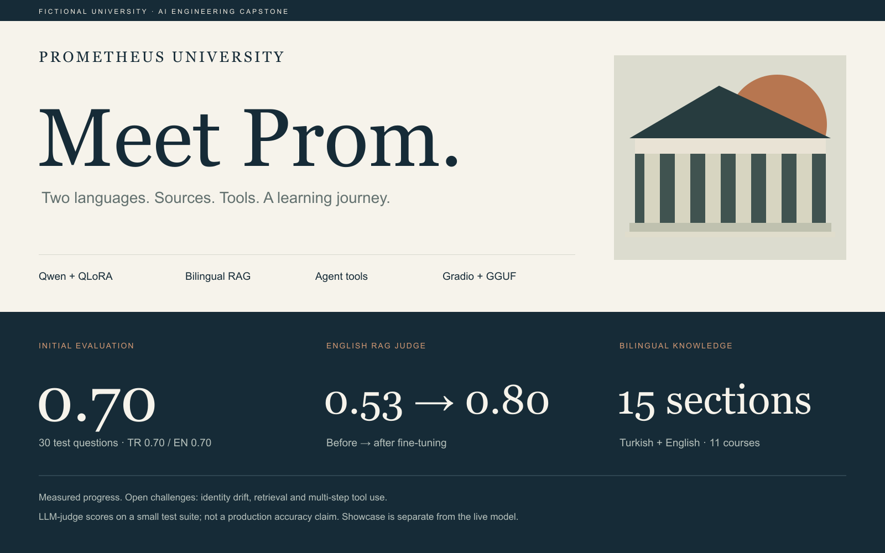

# Prom · Prometheus University



**Explore:** [University showcase](https://tncyypttvk-1.github.io/prom-student-assistant/) · [LinkedIn draft](docs/LINKEDIN.md)

A bilingual Turkish/English student affairs assistant built as an AI Engineering capstone. Prometheus University is a **fictional educational institution**. This project does not perform official student transactions.

## What this repository contains

- `notebooks/Prom_Bitirme_Projesi.ipynb`: Colab pipeline for synthetic data, QLoRA fine-tuning, evaluation, RAG, agents, GGUF and Gradio deployment.
- `src/`: identity, shared agent tools, weighted GPA calculator and retrieval patch.
- `data/`: 15 bilingual guide sections, 11 course records, 30 test questions.
- `site/dist/`: responsive, buildless university showcase, guide explorer, course catalog and browser-local GPA calculator. **The showcase is not connected to the trained model.**
- `docs/results.json`: results shared from Colab, with known limitations.
- `docs/`: architecture, reproducibility notes, GitHub publishing instructions and LinkedIn draft.

## Architecture

`Student question → fine-tuned Qwen → RAG / course lookup / calculator / weighted GPA → answer`

Base model: `Qwen/Qwen2.5-1.5B-Instruct`. Fine-tuning: QLoRA, rank 16, alpha 32, 3 epochs. Identity and tool protocol are shared across training and the Gradio application. Chroma with multilingual embeddings provides notebook retrieval; the original CPU Space pipeline uses TF-IDF. The cleaned-retrieval patch is separately included and its improvement has not yet been verified.

## Results and honest limits

Package-test score: **0.70**, 30 questions; TR **0.70**, EN **0.70**. These are LLM-judge scores on a small test suite, not production accuracy claims.

| Metric | TR before / after | EN before / after |
|---|---|---|
| Name mention | 0.00 / 0.60 | 0.00 / 0.20 |
| Correct tool | 0.50 / 0.83 | 0.33 / 0.83 |
| RAG judge | 0.47 / 0.50 | 0.53 / 0.80 |

Known failures include institution/developer identity hallucinations, wrong Turkish retrieval, language mismatch and incorrect multi-step calculations. Name mention does not measure correct institution identity. The marker rate and JSON validity do not imply factual correctness. These baseline results predate the unverified retrieval fix.

## Run the showcase locally

```sh
python3 -m http.server 8000 --directory site/dist
```

Open `http://localhost:8000`. No package installation or model download is required for the showcase.

## Run training

Upload the notebook to Google Colab, select T4 GPU, store a write-capable Hugging Face token as `HF_TOKEN` in Colab Secrets, and upload `data/rehber.pdf`, `data/dersler.csv`, `data/test_sorulari.csv` and `data/rehber_bolumleri.json`. Run cells in order. Review generated data before training. The notebook targets 720 candidate examples and checks for at least 600 unique training examples; these targets are not a verified actual training count. Save notebook outputs and checkpoints before a Colab session ends.

Never commit access tokens, private student records or model weights. Uploaded weights, dataset and Space URLs must be recorded only once their availability has been verified.

## GitHub Pages

The included workflow deploys `site/dist` when enabled in repository Settings → Pages → GitHub Actions. This serves the static showcase; hosting the trained model requires the separate Gradio/GGUF runtime. No live model URL is configured yet.

## Credits and licensing

Adapted from the Tech İstanbul capstone sample supplied in the course. The university guide and sample data originate from its fictional university package. Base-model license is Apache-2.0; verify upstream sample/data redistribution terms before assigning a blanket repository license. No blanket license is asserted here.
