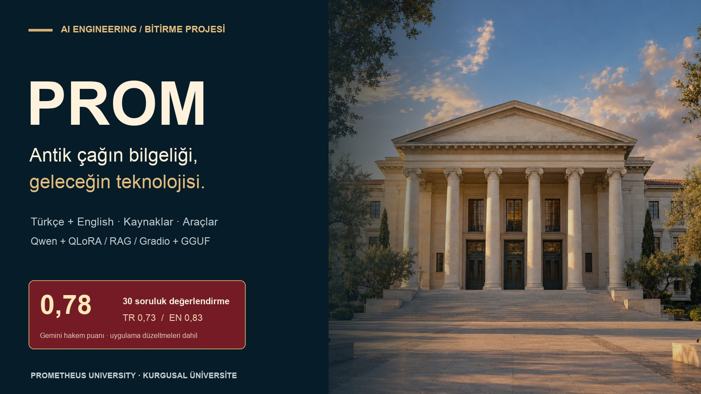
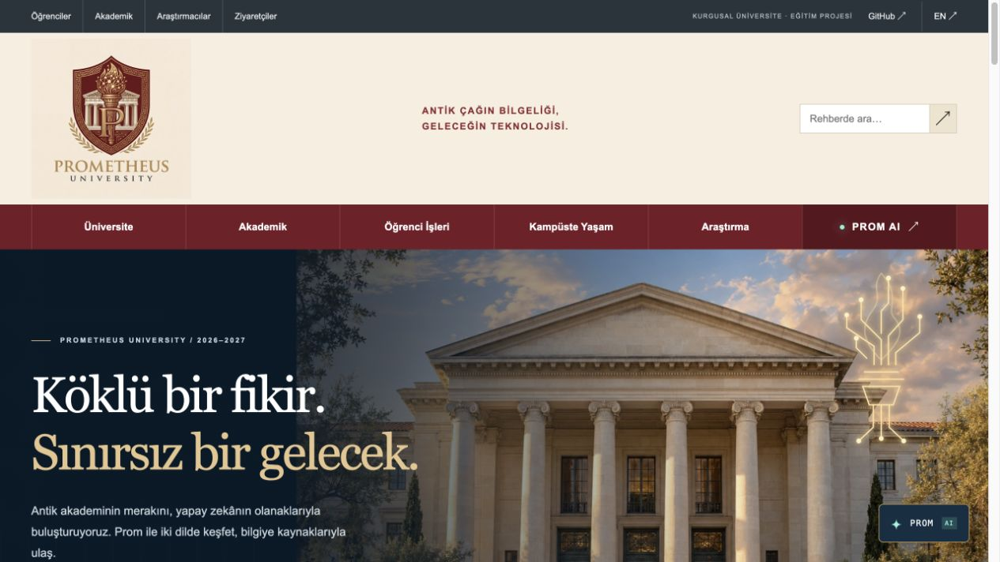
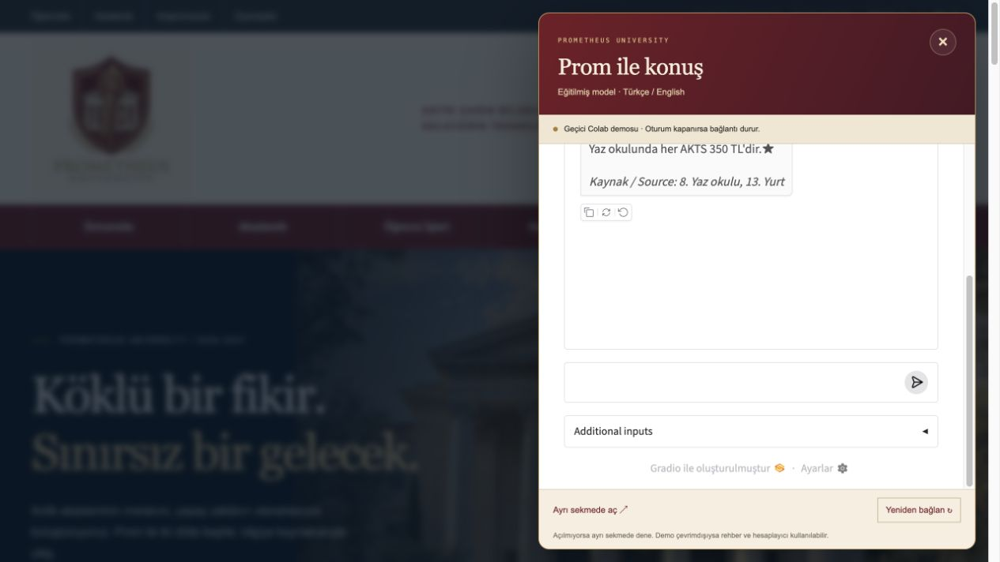
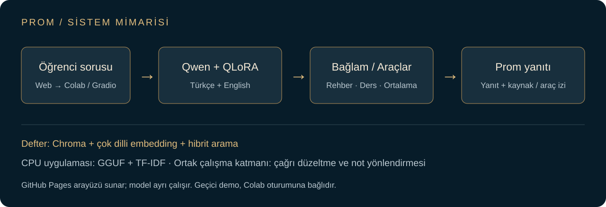

<p align="center"></p>

# Prom · İki dilli yapay zekâ öğrenci asistanı

**Antik çağın bilgeliği, geleceğin teknolojisi.**

Kurgusal Prometheus University için geliştirdiğim AI Engineering bitirme projesi. Türkçe ve İngilizce soruları; ince ayarlanmış bir dil modeli, kaynak getiren arama ve hesaplama araçlarıyla yanıtlıyor. Üniversite deneyimini sunan web sitesi, gerçek Prom modeline açılan sohbet panelini de içeriyor.

**[Web sitesini keşfet ↗](https://tncyypttvk-1.github.io/prom-student-assistant/?v=16)** · **[Çalıştırılmış Colab ↗](https://colab.research.google.com/drive/1-NL5VZoQhPoZOFM7Hq5MaNHQ85zae99j?usp=sharing)** · **[Model ve rapor ↗](https://huggingface.co/tncyypttvk/Prom-1.5B)**

`Qwen2.5-1.5B` · `QLoRA` · `TR / EN` · `RAG` · `Agent tools` · `GGUF` · `Gradio`

## Önce dene

1. Web sitesini aç ve sağ alttaki **PROM** düğmesine bas.
2. Rehber modunda “Yazın bir AKTS kaç para?” diye sor.
3. Ajan modunda “BA (5 AKTS) ve CC (5 AKTS) için ortalamayı hesapla.” sorusunu dene.

Sohbet **geçici Colab bağlantısı** kullanır; oturum sona erdiğinde model çevrimdışı kalabilir. Rehber, ders kataloğu ve tarayıcıdaki hesaplayıcı bağımsız çalışır. Kalıcı model yayını eğitmen vitrini için bekleniyor.

## Projeden görüntüler

| Üniversite web sitesi | Gerçek modele bağlı sohbet |
|---|---|
|  |  |

Kampüs ve laboratuvar görselleri kurgusal üniversite için oluşturulan konseptlerdir. Sohbet görüntüsü 17 Ekim 2026 tarihli gerçek denemeden alınmıştır.

## Prom ne yapıyor?

| Mod | İşlev | Örnek |
|---|---|---|
| Sohbet | İnce ayarlanan modelin kimlik ve dil davranışı | “Sen kimsin?” |
| Rehber / RAG | Üniversite rehberinden bağlam getirip kaynak gösterme | “Yazın bir AKTS kaç para?” → 350 TL |
| Ajan | Ders arama, aritmetik ve AKTS ağırlıklı ortalama | BA ve CC, 5’er AKTS → 2,75 / 4,00 |

Dört araç: `rehberde_ara`, `ders_bilgisi`, `hesapla`, `not_ortalamasi`. Not ortalaması aracı verilen dersler üzerinden hesaplar; resmî GNO üretmez.

## Nasıl çalışıyor?



Temel model **Qwen/Qwen2.5-1.5B-Instruct**; QLoRA ayarları rank 16, alpha 32, 3 epoch. Defterde Chroma ve çok dilli embedding ile hibrit arama; CPU uygulamasında TF-IDF kullanılıyor. Ortak uygulama katmanı çoklu ders çağrısını düzenliyor ve açık not/AKTS örüntülerini ortalama aracına yönlendiriyor.

Web sitesi GitHub Pages üzerinde çalışır. Model hesaplaması Colab/Gradio tarafında yapılır; tarayıcıya Hugging Face anahtarı konmaz.

## Ölçülen sonuçlar

| Son değerlendirme | Puan |
|---|---:|
| Genel | **23,5 / 30 · 0,7833** |
| Türkçe · 15 soru | 0,7333 |
| İngilizce · 15 soru | 0,8333 |
| CPU denemesi | 3 temel örnek |

17 Ekim 2026 tarihli Gemini hakem değerlendirmesi. Sonuç, arama ve ajan kodu düzeltmelerini içerir; modelin tek başına doğruluğu veya CPU üzerinde 30 soruluk başarı ölçümü değildir. Önceki 0,77 koşusuyla hakem puanlamasında farklılık görüldü. Son devam koşusunda yeniden eğitim yapılmadı.

<details>
<summary>Eğitim öncesi / sonrası ölçümler ve sınırlar</summary>

| Ölçüm | Türkçe önce → sonra | İngilizce önce → sonra |
|---|---:|---:|
| Adını söyleme | 0,00 → 0,50 | 0,00 → 0,40 |
| Doğru araç | 0,00 → 0,67 | 0,00 → 0,60 |
| RAG hakem puanı | 0,50 → 0,47 | 0,60 → 1,00 |

Bu ölçümler uygulama düzeltmelerinden öncedir. Türkçe RAG bu ölçümde iyileşmedi. Devamsızlık, kayıt dondurma ve kitap gecikmesi sorularında yanlış/eksik cevaplar; İngilizce soruya farklı dilde yanıt verme hataları sürüyor. Kurallı ortalama yönlendirmesi modelin öğrendiği araç seçimiyle aynı şey değildir. Kayıtlı GGUF ile birleşik GPU modelinin hash eşitliği kanıtlanmadı.

</details>

## Kod ve tekrar çalıştırma

**Başlangıç dosyası: [Prom_Son.ipynb](notebooks/Prom_Son.ipynb).** Son çalıştırılmış defterin kodları ve çıktıları korunmuştur; geçmiş eğitim kanıtları defterin arşiv bölümündedir. Eski `Prom_Bitirme_Projesi.ipynb` önceki sürüm olarak korunur.

| Klasör | İçerik |
|---|---|
| [`notebooks/`](notebooks/) | Son defter ve önceki kaynak sürümü |
| [`src/`](src/) | Güncel uygulama, araçlar, kimlik ve arama modülleri |
| [`data/`](data/) | 15 iki dilli rehber bölümü, 11 ders, 30 test sorusu |
| [`site/dist/`](site/dist/) | Web sitesi ve geçici model bağlantı ayarı |
| [`docs/`](docs/) | Sonuçlar, ekran görüntüleri ve sunum notları |

Web sitesini yerelde açmak için:

```sh
python3 -m http.server 8000 --directory site/dist
```

Ardından `http://localhost:8000` adresini aç. Model indirmek gerekmez. CPU modelini yerelde çalıştırma adımları [kaynak rehberinde](src/README.md).

Colab’da mevcut modelden devam etmek için son defteri aç, T4 GPU seç ve `HF_TOKEN` değerini Colab Secrets’a ekle. Varsayılan `YENIDEN_EGIT=False` mevcut modeli kullanır. Yeniden eğitim ayrı bir yoldur; üretilecek örnekleri incelemeden eğitim onayını açma. İlk çalışma verileri 648 eğitim / 71 doğrulama örneği içeriyordu; 720 aday üretim hedefi gerçek eğitim sayısı değildir.

## Model dosyaları

[Birleşik model / rapor](https://huggingface.co/tncyypttvk/Prom-1.5B) · [LoRA adaptörü](https://huggingface.co/tncyypttvk/Prom-1.5B-LoRA) · [GGUF](https://huggingface.co/tncyypttvk/Prom-1.5B-GGUF) · [Eğitim verisi](https://huggingface.co/datasets/tncyypttvk/prom-1.5b-veri) · [CPU uygulama paketi](https://huggingface.co/tncyypttvk/Prom-1.5B-GGUF/tree/main/space)

`space/` dosya klasörü canlı uygulama adresi değildir. Geçici URL `site/dist/demo-config.js` içinde tutulur; kalıcı `hf.space` adresi hazır olduğunda değiştirilebilir.

## Sonraki adımlar

- Türkçe rehber yanıtlarında kaynak ve cevap tutarlılığını iyileştirmek.
- Dil tutarlılığı ve çok adımlı araç kullanımını yeni sorularla değerlendirmek.
- Kalıcı model yayını ve kısa bir demo videosu hazırlamak.

## Emeği geçenler

Tech İstanbul eğitiminde paylaşılan bitirme projesi örneğinden uyarlanmıştır. Üniversite ve örnek veriler eğitim amaçlı kurgusaldır. Temel modelin lisansı Apache-2.0’dır; ders materyalleri için ayrıca dağıtım koşulları geçerlidir. Depo genelinde kapsamlı bir lisans iddiası yapılmamıştır.
